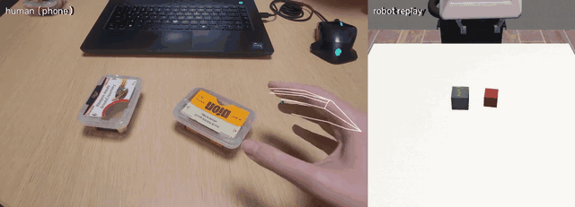
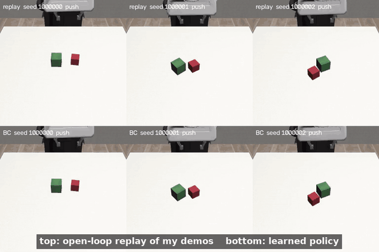
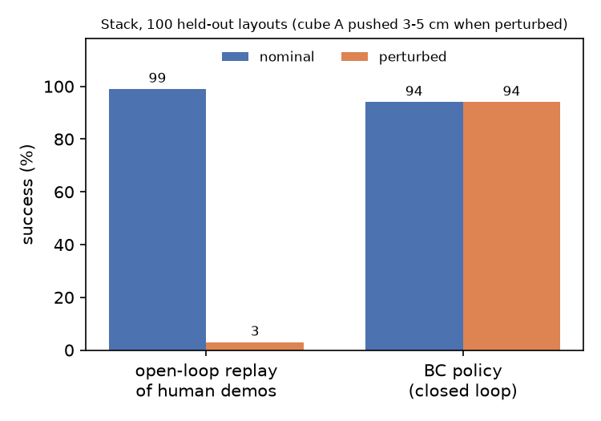
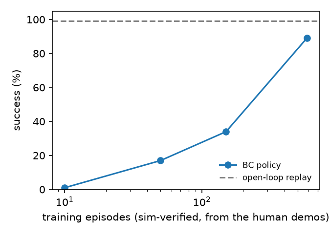
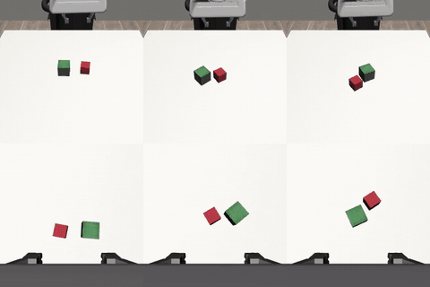
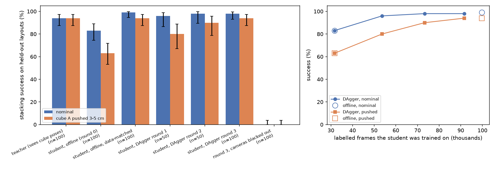
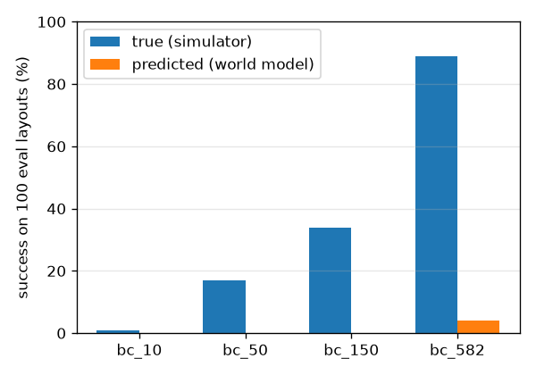

# From my hand to a robot arm: stacking from one phone video

I filmed my right hand stacking one small box on another with my phone (2 minutes, 7 stacks). This repo turns that video into a robot policy that stacks cubes in simulation (robosuite `Stack`, Franka Panda), and then distils that policy into a vision-language-action model (SmolVLA) that sees only two cameras, the robot's own pose and the instruction "put the red cube on the green cube". Every robot trajectory used for training descends from my own demonstrations; there is no scripted expert anywhere in the loop.



## Results

All numbers are on held-out cube layouts (random positions and rotations, seeds never used for training). Success is robosuite's own `Stack` check, judged the same way for both arms: the policy must keep cube A on cube B for 3 s while it goes on acting, and replay is checked after it has finished its retreat. "Open-loop replay" means the plan is retargeted once from the initial layout and then executed without looking at the cubes again.

| | nominal layouts | cube A pushed 3-5 cm before the grasp |
|---|---|---|
| open-loop replay of my 7 retargeted demos | 99 % | 3 % |
| BC policy trained on sim-verified rollouts of my demos (sees cube positions) | 94 % | 94 % |
| **SmolVLA distilled from that policy (sees two cameras, no cube positions)** | **98 %** | **94 %** |



- Replay follows my hand's path anchored to where the cubes are at the start, so it cannot react when a cube moves. The learned policy closes the loop and recovers. On undisturbed layouts it is still 5 points below replay. Of its 6 failures, 1 never picks cube A up, 2 hold it beside cube B without letting go, 1 lets go of it 5 cm away from cube B, and 2 put it on cube B but do not hold the stack for the required 3 s before the 20 s time limit.
- **Data scaling:** BC success is 1 %, 17 %, 34 % and 89 % with 10, 50, 150 and 582 training episodes (subsets of a 600-layout run), and 94 % with the 1,527 episodes of a 1,600-layout run. With about as many episodes as I recorded, behaviour cloning learns almost nothing; the simulator-verified multiplication is what makes it work.
- **Other arms:** the retargeted plan lives in end-effector space, so the same demos drive other robots unchanged: open-loop replay stacks 99 % on the Panda, 91 % on the KUKA IIWA, 81 % on the UR5e and 79 % on the Kinova3 (7 demos x 20 layouts each).






## From cube positions to cameras: distilling the policy into SmolVLA

The BC policy reads the cube poses from the simulator, which a real robot would not have. I distilled it into LeRobot's SmolVLA (450M parameters), the VLA the challenge suggests: the BC policy is the teacher, and the student sees only the agentview and wrist cameras (256x256), the end-effector pose and gripper opening, and the instruction (`hc/vla_env.py`, `hc/vla_student.py`, `hc/distill.py`, `hc/vla_train.py`, `scripts/09_distill_vla.py`).

- **Initialisation.** The student starts from `lerobot/smolvla_libero`. LIBERO is also robosuite with a Panda, 20 Hz delta end-effector actions and the same two kinds of camera, so I feed the student LIBERO's observation conventions (image orientation, 8-D state) and my action space needs no mapping.
- **Labels.** The teacher can be queried at any state, because the simulator always knows where the cubes are. Every recorded frame is labelled with the teacher's own predicted 8-step action chunk at that state, whoever was driving the robot.
- **Round 0 (offline).** The teacher drives 400 layouts with action noise (σ = 0.1 on the arm, as in the data multiplication) and I keep the 374 that stack: 33k frames, 3,000 updates. The student stacks 83 % of held-out layouts and 63 % with the push.
- **DAgger rounds (on-policy).** In each of 3 rounds the student drives 200 new layouts and the teacher labels every state it visits; a share of episodes (50 %, 25 %, 0 %) hands over to the teacher midway so the data also shows recoveries from the student's own mistakes. All rounds are aggregated and the student is fine-tuned for 1,500 more updates each round. Success goes 96/80 %, 98/90 % and 96/96 % (nominal/pushed, 50 layouts) and reaches 98/94 % on the 100 evaluation layouts after round 3.
- **The control that changed my reading.** An offline student trained on as much teacher data as DAgger collected (1,112 noisy teacher rollouts, 100k frames against DAgger's 92k) for as many updates (7,500) reaches 99/94 %. So at equal data and training, rollouts of the noisy teacher were as good as the student's own states: what lifted the student from 83/63 % was more labelled data and more updates (three times the frames, 2.5 times the updates), not the on-policy part; this run does not separate the two. A likely reason is the action noise, which already puts recovery states into the teacher's data, the effect DAgger would otherwise add (DART, Laskey et al. 2017).
- **It uses its eyes.** With both camera images replaced by black frames the round-3 student stacks 0 of 100 layouts.



## How it works

```
phone video ─► MediaPipe hand landmarks ─► metric 3-D pinch point ─► 7 demos in a table frame
   ─► object-centric retargeting ─► replay on hundreds of random layouts, keep the successes
   ─► behaviour cloning (MLP + action chunks) ─► closed-loop policy on cube positions
   ─► distillation (teacher labels on noisy teacher rollouts + DAgger) ─► SmolVLA on two cameras
```

1. **Hand tracking** (`hc/hand_tracking.py`). MediaPipe's hand landmarker gives 21 image points per frame and the same 21 points as a metric 3-D hand model.
2. **Metric 3-D from one uncalibrated camera** (`hc/lifting.py`). The 3-D hand model has the right size but no position. Its 21 points and their 21 image projections fix the hand's translation by linear least squares (a PnP problem with known rotation), given a nominal phone field of view. The robot's gripper maps to the point between my thumb and index fingertips; the thumb-index distance is the aperture.
3. **Segmentation** (`hc/segmentation.py`). Each demo runs from the hand entering the view to it leaving, cut around a grasp and a release.
4. **Object-centric retargeting** (`hc/retarget.py`). My grasp point is mapped onto cube A and my release point onto the top of cube B by a planar similarity transform; heights keep their metric offsets from those anchors. Between them the robot follows the shape and timing of my hand. Because both ends are pinned to the objects, one demo works for any cube layout.
5. **Sim-verified data multiplication** (`hc/datagen.py`). Each demo is replayed on hundreds of random layouts with small action noise, and only the episodes the simulator scores as successful are kept (1,527 of 1,600 layouts). The recorded actions are the clean tracking commands, while the executed ones are noisy, so the data shows how to correct small errors.
6. **Behaviour cloning** (`hc/policy.py`). A 3-layer MLP maps a 21-D state (gripper pose and opening, both cube poses and their offsets) to the next 8 actions; overlapping predictions are averaged at run time (temporal ensembling, as in ACT).
7. **Distillation into SmolVLA** (`hc/distill.py`, `hc/vla_train.py`, `scripts/09_distill_vla.py`). The BC policy labels frames from both cameras rendered in simulation, and SmolVLA learns to act from the images alone (details above).

## Design choices

- **The pinch point, not the wrist.** A parallel gripper closes where my thumb and index meet, so that point is what the end-effector should follow.
- **Anchor on the objects, not on the camera.** My boxes, my table and my camera pose differ from the simulator. Mapping the two moments that matter (grasp and release) onto the sim objects removes most of that gap and turns 7 fixed demos into a family of plans for any layout.
- **Keep the motion, constrain the contact.** My fingers wrap around a box from any angle; a parallel gripper needs to come down vertically. The retargeted path keeps my approach and carry but forces the last few centimetres before the grasp and before the release to be vertical, and turns the gripper to the cube faces that are perpendicular to the carry direction. This is the main embodiment gap I hit.
- **The simulator is the filter.** I do not hand-tune each replay; I generate many and keep what the physics says worked. My demos decide how the robot moves, the simulator decides which attempts count.
- **A small policy on state first, then a VLA.** With 7 demos and a laptop CPU, a low-dimensional policy trains in about a minute, which let me measure success over hundreds of layouts. It then serves as a teacher: privileged information makes the teacher easy to train, and the simulator lets it label any state the camera-only student reaches.

## What worked and what did not

Worked:
- MediaPipe tracking on 1080p phone video was solid when the hand was fully in view.
- Object-centric anchoring: open-loop replay of my demos already stacks on most new layouts.
- Data multiplication + BC: the policy keeps its 94 % when cube A is pushed before the grasp, where replay drops to 3 %.

Did not work, or only partly:
- **My first retargeting copied my timing too literally.** In the real clip my hand often enters the view less than half a second before it grasps, so the robot was given half a second to travel 20 cm from its home pose and hit the cube at an angle. Three of my seven demos replayed badly (30-75 %) until the approach got a minimum duration of 1.5 s; replay went from 84 % to 99 %. Synthetic demos never showed this because the synthetic hand is always visible.
- **The first policy trained on my real demos stacked only 58 %** (replay: 99 %). It carried cube A to within a centimetre of cube B and then held it there forever. The cause was in my data: I set the box down and adjusted it for 1.7-3.4 s before opening my hand, and the plan copied that wait. The policy only sees the current state, so it saw "keep holding" many times and "open" a few times at the same state, and kept holding. Ending the carry 0.3 s after my hand first arrives over the place spot (`carry_end` in `hc/retarget.py`) fixed it without changing replay success: the policy went from 58 % to 89 % (and from 56 % to 89 % with the push).
- **Monocular depth is noisy.** Heights from the hand-model fit wander by several centimetres; the retargeting keeps metric height offsets but clamps the carry height for that reason.
- **Automatic segmentation failed on my real clip.** It assumed fixed pick and place spots, but I alternated which box went on top and moved them around, and my hand left the view between repetitions. I labelled grasp and release times by hand (`data/raw/stack_main_events.json`, 7 pairs of numbers); everything else is automatic.
- **Camera-motion compensation.** The phone was hand-held. Registering frames to the first frame failed because the boxes I moved are part of the background; chaining frame-to-frame homographies drifted over two minutes. The final pipeline runs without it; `--stabilize` turns the experiment back on.
- **The 15-second clip** (dark table, strong lamp) only had the hand detected in 39 % of frames and is not used for training.
- **Self-improvement**, starting from the 582-episode policy (roll out the policy on 150 new layouts with exploration noise, keep the 130 that stacked, retrain on all 712 episodes) moved success from 89 % to 94 % on undisturbed layouts and from 89 % to 85 % with the push. With 100 evaluation layouts the standard error is about 4 points, so one round did not clearly help or hurt.
- **A first camera-based policy trained from scratch got 0 of 50 layouts**: a small CNN on one 84x84 `agentview` image, 157 rendered episodes, about 1,000 updates on a CPU (`hc/vision_policy.py`, `scripts/08_vision_bc.py`). The arm came down near the cubes and hovered beside them. The distilled SmolVLA replaced it: a pretrained model, a wrist camera, and about 7 times more labelled frames and updates, on a GPU.
- **DAgger was not needed here.** At equal data the offline student from noisy teacher rollouts matched it (above). The student's own success while collecting did rise from 70 % to 88 % over the rounds, so its states were not wasted, but they were not better than the teacher's.
- **SmolVLA fine-tuning in LeRobot 0.4.4 needed three fixes.** Its loss mask for chunk steps past the end of an episode reads a misspelt key and is never applied, so I train on the teacher's full chunks instead. Building the model without downloading the base VLM leaves the VLM in float32, and the action expert's weights are bfloat16, so AdamW rounded most updates late in the schedule to zero; I cast the VLM back to bfloat16 and train the expert in float32. Leaving the 25 zero-padded action dimensions out of the loss, which looks like a clean-up, would let their velocities drift although inference integrates them.
- **Jaco** (three-finger hand) never holds the cube with the same plan; it would need its own grasp. Sawyer does not load under MuJoCo 3.3.5.

## Where VLAs and world models fit

The VLA is post-trained by distillation from the state policy (above), with the simulator as the bridge: it renders the cameras the VLA needs and knows the cube positions the teacher needs. A natural next step is a harder test that only vision can solve, such as moving cube B while cube A is carried.

I did try one world-model experiment (`hc/world_model.py`, `scripts/07_world_model.py`): an action-conditioned dynamics model on the policy state, trained on the sim-verified episodes plus 300 rollouts of four policies of different quality (so it also sees failures), then used as a learned simulator to score those four policies offline.
- **Short horizons work.** Over about 10 steps it predicts the gripper and a held cube to about 1 cm.
- **As a simulator it fails.** It predicts 0 %, 0 %, 0 % and 4 % stacking success for policies that really reach 1 %, 17 %, 34 % and 89 %. Inside the model, cubes that should rest drift (cube B moves a median 2.6 cm over 300 steps although it never moves), so the placement misses by more than the 1.5 cm a stack needs. For a resting cube it is worse than predicting no motion at all.
- **What I would try next:** keep a cube still unless the gripper touches it, train on multi-step losses, and use an ensemble whose disagreement flags rollouts that cannot be trusted.



## Run it

Python 3.11. Stages 1-8 run on a CPU; the SmolVLA student (stage 9) needs a CUDA GPU. I ran stage 9 on one A100 80 GB: round-0 training takes 16 min (3,000 updates at batch 32, peak 7 GB of GPU memory, so a 16 GB card is enough), each DAgger round about 30 min (13 min collecting 200 episodes, 8 min training, 10 min evaluating), and evaluating 100 layouts in both conditions about 15 min. Everything in this README, including the controls, took about 5 A100-hours. Large files (rendered datasets, checkpoints) go to `$HC_VLA_ROOT` (default `/var/tmp/humanoid_vla`).

```bash
pip install -r requirements.txt     # torch CPU wheels are enough
pytest -q
# the whole pipeline on synthetic hand tracks, no video needed
scripts/run_all.sh --synthetic
```

My phone clip (187 MB) is not in the repo. What it produced is: the cached hand track (`data/processed/stack_main_track.npz`), the 7 demos (`data/processed/stack_main_demos.npz`), the hand-labelled events and a 640 px video of the tracking (`outputs/perception/stack_main_overlay.mp4`). Everything from retargeting onward runs from those files (stage 2 without `--video`); with the clip placed at `data/raw/stack_main.mp4`, `scripts/run_all.sh data/raw/stack_main.mp4` runs it all.

The headline numbers come from `outputs/stack_main1600/eval/` (policy `data/processed/stack_main1600_bc.pt`, 1,600 layouts); `outputs/stack_main/eval/` holds the 600-layout run with the scaling study and the self-improvement round.

Stage by stage:

| step | script | output |
|---|---|---|
| video → demos | `scripts/01_extract_demos.py --video data/raw/stack_main.mp4` | `data/processed/stack_main_demos.npz`, `outputs/perception/` |
| replay + other arms | `scripts/02_replay_demos.py` | `outputs/stack_main/replay/` |
| data multiplication | `scripts/03_generate_data.py --n 1600` | `data/processed/stack_main_episodes.npz` |
| behaviour cloning | `scripts/04_train_bc.py` | `data/processed/stack_main_bc.pt` |
| evaluation | `scripts/05_evaluate.py --n-eval 100 --scaling` | `outputs/stack_main/eval/` |
| self-improvement | `scripts/06_self_improve.py` | `outputs/stack_main/eval/self_improve.json` |
| world model | `scripts/07_world_model.py` | `outputs/stack_main/world_model/` |
| camera policy (first attempt) | `scripts/08_vision_bc.py data`, then `train`, then `eval` | `outputs/stack_main/vision/` |
| SmolVLA student | `scripts/09_distill_vla.py teacher-data`, `train --round 0`, `dagger`, `eval --ckpt r3` (see the script's docstring) | `outputs/stack_main/vla/` |

## Layout

```
hc/            pipeline modules (types, sim, tracking, lifting, segmentation, retarget, datagen, policy, evaluate, world_model, vision_policy,
               vla_env, vla_student, distill, vla_train)
scripts/       numbered entry points and run_all.sh
tests/         pytest, including a synthetic round trip with known ground truth
data/raw/      my clips and hand-labelled event times
outputs/       plots, videos and result JSONs
```
